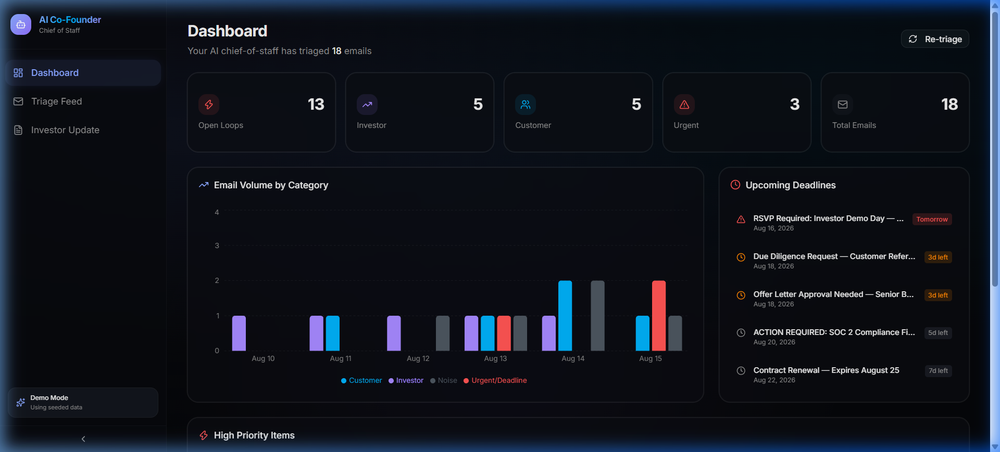
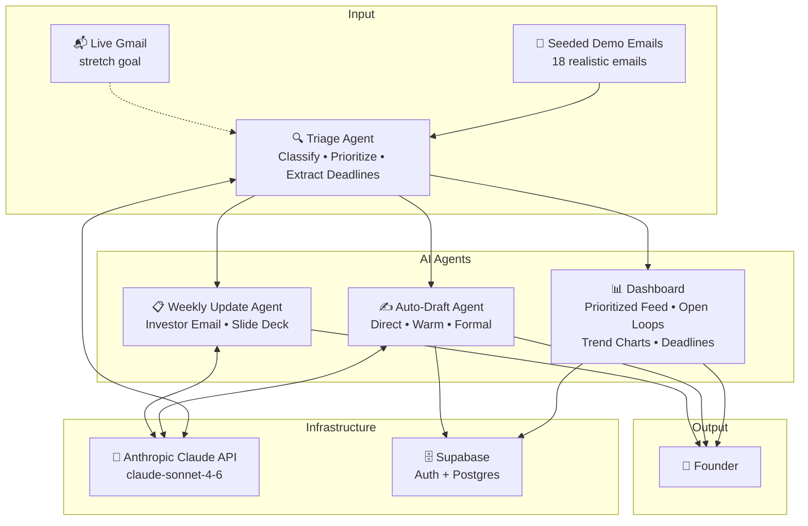

# 🤖 AI Co-Founder

**An AI chief-of-staff for early-stage founders** — triages your inbox, flags anything time-critical (investor follow-ups, customer issues, deadlines), drafts responses in your voice, and turns the week's activity into a ready-to-send investor update.



---

## The Problem

Solo and early-stage founders lose deals and miss commitments because nothing proactively surfaces what matters out of inbox noise. You're juggling investor threads, customer escalations, compliance deadlines, and hiring approvals — all mixed in with newsletters and cold outreach. A human co-founder would own this ops layer. Most founders don't have one yet.

## The Solution

AI Co-Founder acts as your AI chief-of-staff. It classifies every email into Investor, Customer, Urgent/Deadline, or Noise; extracts deadlines and action items; presents a prioritized dashboard with trend analytics; generates contextual reply drafts in your preferred tone; and synthesizes the week's activity into a polished investor update email with a mini slide deck.

## 🔗 Links

| | Link |
|---|---|
| **Live Demo** | [ADD VERCEL URL] |
| **Demo Video** | [ADD DEMO VIDEO LINK] |
| **GitHub Repo** | [github.com/Devengoyal885/AI-Cofounder](https://github.com/Devengoyal885/AI-Cofounder) |

---

## Architecture



---

## How It Works

### 🔍 Triage Agent
Takes a batch of emails and classifies each into **Investor**, **Customer**, **Urgent/Deadline**, or **Noise**. For anything with a deadline or time-sensitive ask, it extracts the specific date and action into structured JSON and assigns a priority score (1-5). The full pipeline runs through Claude's API in a single batch call for efficiency. → [View prompt](docs/prompts/triage-agent.md)

### ✍️ Auto-Draft Agent
For any flagged email, generates a suggested reply in the founder's voice with a configurable tone setting: **Direct** (concise, no-fluff), **Warm** (friendly, relationship-building), or **Formal** (polished, board-appropriate). The founder can edit the draft and mark it as "sent" — no real email sending required, this is a productivity workflow. → [View prompt](docs/prompts/draft-agent.md)

### 📋 Weekly Update Agent
Synthesizes the week's triaged data — deals moved, customer themes, resolved and open items — into a ready-to-send **investor update email** formatted in markdown, plus a **4-5 slide mini pitch-style summary**. This same agent was used to help draft parts of the actual hackathon pitch deck. → [View prompt](docs/prompts/weekly-update-agent.md)

---

## Backstory

This project builds on the **classify → extract urgency/deadlines → alert → dashboard → AI-drafted action** pattern proven in the builder's prior projects:

- **MailIQ**: AI email classification, deadline extraction, and proactive alerting
- **Bharat-Intelligence**: AI-classified triage feed and trend-analysis dashboard for a citizen-grievance platform

AI Co-Founder applies that same proven architecture to the founder-ops problem — replacing the ops layer a human co-founder would normally own with an AI agent pipeline.

---

## Tech Stack

| Layer | Technology |
|-------|-----------|
| **Frontend + Backend** | Next.js 16 (App Router) + TypeScript |
| **Styling** | Tailwind CSS v4 + shadcn/ui |
| **AI** | Anthropic Claude API (`claude-sonnet-4-6`) |
| **Database / Auth** | Supabase (Postgres + Auth) |
| **Charts** | Recharts |
| **Deployment** | Vercel |
| **Package Manager** | npm |

---

## AI Usage Report

### Runtime AI (Production)
- **Claude `claude-sonnet-4-6`** powers all three runtime agents (Triage, Draft, Weekly Update) via the Anthropic API
- Each agent has a carefully crafted system prompt — see [`/docs/prompts/`](docs/prompts/)
- The **Weekly Update Agent** was also used to help draft this hackathon's own pitch deck (it synthesizes real product activity into slide format)

### Development AI
- **Antigravity (Claude)** was used for initial scaffolding, code generation, and deployment automation
- Estimated AI-generated code: **~80%** of boilerplate/scaffold, **~50%** of core business logic (agent prompts, classification rules, dashboard components)
- All AI-generated code was reviewed and iteratively refined by the builder

### Prompt Transparency
All three agent system prompts are committed as standalone markdown files:
- [Triage Agent Prompt](docs/prompts/triage-agent.md)
- [Draft Agent Prompt](docs/prompts/draft-agent.md)
- [Weekly Update Agent Prompt](docs/prompts/weekly-update-agent.md)

---

## Repo Structure

```
ai-cofounder/
├── src/
│   ├── app/                          → Next.js app pages
│   │   ├── api/
│   │   │   ├── triage/route.ts       → Triage API endpoint
│   │   │   ├── draft/route.ts        → Draft API endpoint
│   │   │   └── weekly-update/route.ts → Weekly update API endpoint
│   │   ├── dashboard/
│   │   │   ├── layout.tsx            → Dashboard shell with sidebar
│   │   │   ├── page.tsx              → Main dashboard (stats, charts, deadlines)
│   │   │   ├── feed/page.tsx         → Triage feed with draft panel
│   │   │   └── investor-update/page.tsx → Weekly update views
│   │   ├── layout.tsx                → Root layout
│   │   ├── page.tsx                  → Landing page
│   │   └── globals.css               → Design system & theme
│   ├── components/
│   │   ├── ui/                       → shadcn/ui primitives
│   │   ├── trend-chart.tsx           → Recharts trend visualization
│   │   └── deadline-list.tsx         → Deadline countdown list
│   └── lib/
│       ├── agents/
│       │   ├── triage.ts             → Triage Agent (classify, extract, prioritize)
│       │   ├── draft.ts              → Auto-Draft Agent (tone-aware replies)
│       │   └── weekly-update.ts      → Weekly Update Agent (email + slides)
│       ├── data/
│       │   └── seed-emails.json      → 18 realistic demo emails
│       ├── types.ts                  → TypeScript type definitions
│       └── utils.ts                  → Utility functions
├── docs/
│   ├── prompts/
│   │   ├── triage-agent.md           → Triage system prompt
│   │   ├── draft-agent.md            → Draft system prompt
│   │   └── weekly-update-agent.md    → Weekly update system prompt
│   └── assets/                       → Screenshots & media
├── .env.example                      → Environment variable template
├── .gitignore
├── LICENSE                           → MIT
├── README.md                         → This file
└── package.json
```

---

## Local Setup

### Prerequisites
- Node.js 18+
- npm
- Anthropic API key ([get one here](https://console.anthropic.com/))

### Steps

```bash
# 1. Clone the repo
git clone https://github.com/Devengoyal885/AI-Cofounder.git
cd AI-Cofounder

# 2. Install dependencies
npm install

# 3. Set up environment variables
cp .env.example .env.local
# Edit .env.local and add your ANTHROPIC_API_KEY

# 4. Run the dev server
npm run dev
```

Open [http://localhost:3000](http://localhost:3000) and click **Launch Dashboard**.

> **💡 Demo Mode works without any API key** — the app includes a rule-based fallback triage engine. Adding your Anthropic API key enables the full Claude-powered AI agents for more accurate classification and natural draft generation.

---

## Team / Hackathon Track

| | |
|---|---|
| **Track** | AI SaaS Startup |
| **Builder** | Dev Goyal |
| **Hackathon** | 48-72 hour AI-first startup hackathon |
| **Focus** | Real working deployment with visible agentic AI usage |

---

## License

[MIT](LICENSE)
