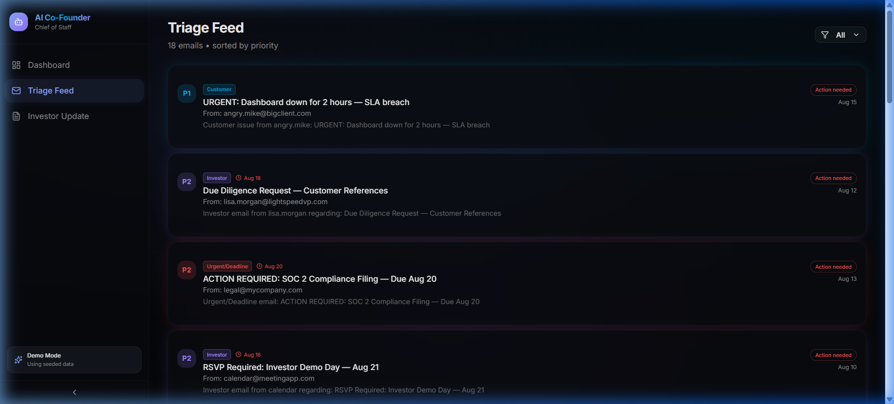
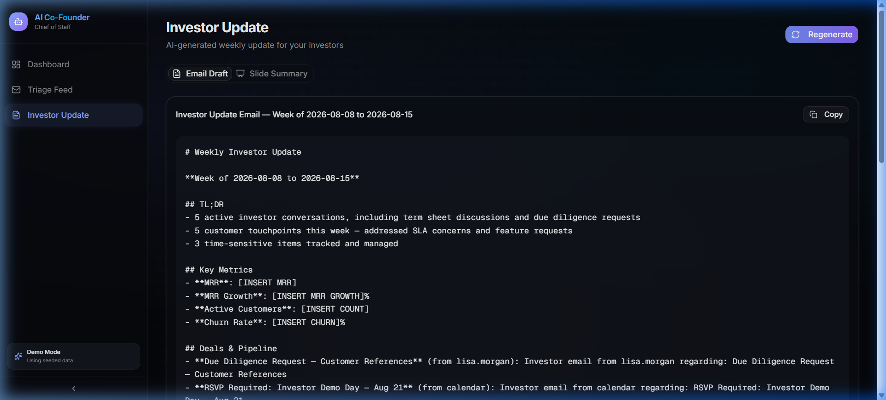
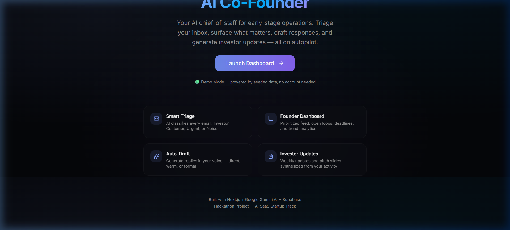
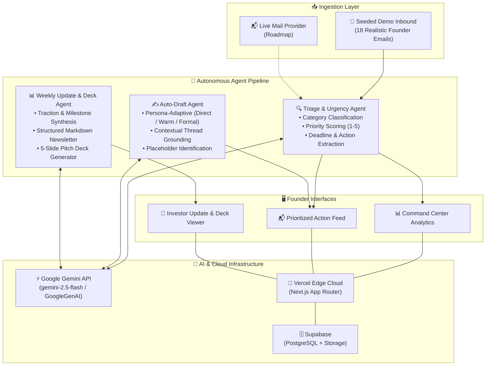

# 🤖 AI Co-Founder — The Autonomous Chief-of-Staff for Solo & Early Founders

<div align="center">

[](https://ai-cofounder-gilt.vercel.app/dashboard)
[](https://github.com/Devengoyal885/AI-Cofounder)
[](https://github.com/HackIndiaXYZ/ai-first-startup-hackathon-build-a-startup-using-ai-only-arclight)
[](LICENSE)

<br />

**Never drop a deal, miss a deadline, or delay an investor update again.**  
*AI Co-Founder proactively triages your founder inbox, flags critical commitments, drafts high-converting context-aware replies in your voice, and auto-synthesizes the week's traction into investor-ready updates and slide decks.*

<br />

[🚀 **Explore Live Dashboard**](https://ai-cofounder-gilt.vercel.app/dashboard) • [✨ **Landing Page**](https://ai-cofounder-gilt.vercel.app) • [📖 **Prompt Library**](docs/prompts/) • [🏗️ **Architecture**](#-system-architecture)

<br />


</div>

---

## ⚡ Quick Links & Live Deployments

| Resource | Link |
| :--- | :--- |
| 🌐 **Live Web App (Dashboard)** | [**ai-cofounder-gilt.vercel.app/dashboard**](https://ai-cofounder-gilt.vercel.app/dashboard) |
| 🏠 **Landing Page** | [**ai-cofounder-gilt.vercel.app**](https://ai-cofounder-gilt.vercel.app) |
| 📬 **Triage & Auto-Draft Feed** | [**ai-cofounder-gilt.vercel.app/dashboard/feed**](https://ai-cofounder-gilt.vercel.app/dashboard/feed) |
| 📊 **Investor Update & Slide Deck** | [**ai-cofounder-gilt.vercel.app/dashboard/investor-update**](https://ai-cofounder-gilt.vercel.app/dashboard/investor-update) |
| 🐙 **Primary GitHub Repository** | [**Devengoyal885/AI-Cofounder**](https://github.com/Devengoyal885/AI-Cofounder) |
| 🏆 **Hackathon Submission Repository** | [**HackIndiaXYZ/ai-first-startup-hackathon**](https://github.com/HackIndiaXYZ/ai-first-startup-hackathon-build-a-startup-using-ai-only-arclight) |

---

## 🎯 The Problem

Early-stage and solo founders wear 10 hats simultaneously. Every day brings a relentless avalanche of inbound communication:

* **High-stakes VC emails** requesting urgent Cap Tables and due diligence.
* **Customer escalation tickets** threatening enterprise churn.
* **Critical compliance & legal deadlines** that risk penalties if missed.
* **Noise & cold outreach** burying the signals that actually move the needle.

Human co-founders and Chiefs of Staff traditionally manage this operational layer. But when you are solo or pre-scale, **inbox chaos means missed deals, broken commitments, and lost momentum**.

---

## 💡 The Solution

**AI Co-Founder** replaces that missing operational partner with a specialized, multi-agent AI pipeline powered by **Google Gemini**:

1. 🔍 **Autonomous Inbox Triage**: Instant classification into `Investor`, `Customer`, `Urgent/Deadline`, or `Noise` with 1–5 urgency ranking and ISO deadline extraction.
2. 📊 **Command Center Dashboard**: Real-time operational pulse, active deadlines, categorical email breakdowns, and priority trends.
3. ✍️ **Voice-Tuned Auto-Drafts**: Contextual email replies drafted in seconds with selectable tone profiles (*Direct*, *Warm*, or *Formal*).
4. 📈 **Auto-Generated Investor Updates**: Transforms a week's operational events into a clean markdown newsletter and a 5-slide mini pitch deck.

---

## 📸 Product Walkthrough & Visuals

### 1. 🎛️ Founder Command Dashboard
> Proactively surfaces imminent deadlines, urgency distributions, and actionable open loops.

<p align="center">
  
</p>

---

### 2. ⚡ AI Triage & Voice-Tuned Auto-Drafting
> Instant classification with tone-switchable draft replies referencing specific thread details.

<p align="center">
  
</p>

---

### 3. 📋 Weekly Investor Updates & Mini Slide Deck
> One-click synthesis from raw weekly activity into investor communications and slide presentations.

<p align="center">
  
</p>

---

### 4. 🚀 Minimalist Landing Interface
> Clean onboarding experience with instant Demo Mode access.

<p align="center">
  
</p>

---

## 🏗️ System Architecture



---

## 🤖 Deep Dive: AI Agents & Prompt Engineering

Every agent operates with strict system instructions and typed output validation:

| Agent | Model | Primary Responsibility | Prompt Spec |
| :--- | :--- | :--- | :--- |
| **🔍 Triage Agent** | `gemini-2.5-flash` | Classifies categories, assigns 1–5 urgency scores, extracts deadlines in ISO 8601, and extracts required founder actions in structured JSON. | [`triage-agent.md`](docs/prompts/triage-agent.md) |
| **✍️ Auto-Draft Agent** | `gemini-2.5-flash` | Analyzes sender relationships and drafts personalized replies in 3 configurable founder tones: *Direct*, *Warm*, or *Formal*. | [`draft-agent.md`](docs/prompts/draft-agent.md) |
| **📋 Weekly Update Agent** | `gemini-2.5-flash` | Aggregates all closed/open loops, customer signals, and investor activity into a professional investor email + 5 mini pitch slides. | [`weekly-update-agent.md`](docs/prompts/weekly-update-agent.md) |

---

## 🛠️ Technology Stack

```
Frontend & Framework   │ Next.js 16 (App Router, Turbopack, TypeScript)
Styling & Design       │ Tailwind CSS v4 + shadcn/ui + Lucide Icons + Glassmorphism
AI & LLM Engine        │ Google Gemini API (@google/genai, gemini-2.5-flash)
Data Visualizations    │ Recharts (Time-series trends & priority breakdowns)
Database & Storage     │ Supabase (PostgreSQL + Auth)
Deployment & Edge      │ Vercel Cloud Platform
Package Management     │ npm
```

---

## 🚀 Getting Started Locally

### 1. Prerequisites
- **Node.js**: v18.0.0 or higher
- **npm**: v9.0.0 or higher
- **Google Gemini API Key**: [Get one on Google AI Studio](https://aistudio.google.com/) *(optional — works in Demo Mode out of the box)*

### 2. Clone & Install
```bash
# Clone the repository
git clone https://github.com/Devengoyal885/AI-Cofounder.git

# Navigate to project folder
cd AI-Cofounder/ai-cofounder

# Install dependencies
npm install
```

### 3. Configure Environment
```bash
# Copy example configuration
cp .env.example .env.local
```

Add your Gemini API Key to `.env.local`:
```env
GEMINI_API_KEY=your_gemini_api_key_here
```

### 4. Run Development Server
```bash
npm run dev
```

Visit [**http://localhost:3000**](http://localhost:3000) or navigate directly to [**http://localhost:3000/dashboard**](http://localhost:3000/dashboard).

> **💡 Zero-Config Demo Mode**: The application includes high-fidelity seeded founder emails and fallback rule-based classification so evaluators can test 100% of the UI flows even without configuring API keys.

---

## 📁 Repository Structure

```
ai-cofounder/
├── docs/
│   ├── assets/                       # High-res UI screenshots & media
│   │   ├── dashboard-screenshot.png
│   │   ├── feed-screenshot.png
│   │   ├── investor-update-screenshot.png
│   │   └── landing-screenshot.png
│   └── prompts/                      # Standalone system prompt specifications
│       ├── triage-agent.md
│       ├── draft-agent.md
│       └── weekly-update-agent.md
├── src/
│   ├── app/
│   │   ├── api/
│   │   │   ├── triage/route.ts       # Triage API endpoint (Gemini)
│   │   │   ├── draft/route.ts        # Auto-Draft API endpoint (Gemini)
│   │   │   └── weekly-update/route.ts# Investor Update API endpoint (Gemini)
│   │   ├── dashboard/
│   │   │   ├── layout.tsx            # Navigation sidebar shell
│   │   │   ├── page.tsx              # Analytics, deadlines & stats overview
│   │   │   ├── feed/page.tsx         # Prioritized inbox feed & draft drawer
│   │   │   └── investor-update/page.tsx # Weekly memo & presentation slide deck
│   │   ├── layout.tsx                # App root layout & providers
│   │   ├── page.tsx                  # Hero landing page
│   │   └── globals.css               # Design system & dark glass theme
│   ├── components/
│   │   ├── ui/                       # Reusable UI primitives
│   │   ├── trend-chart.tsx           # Interactive analytics charts
│   │   └── deadline-list.tsx         # Real-time deadline tracker
│   └── lib/
│       ├── agents/
│       │   ├── triage.ts             # Google Gemini Triage Engine
│       │   ├── draft.ts              # Google Gemini Tone-Aware Draft Engine
│       │   └── weekly-update.ts      # Google Gemini Memo & Deck Engine
│       ├── data/
│       │   └── seed-emails.json      # 18 curated realistic founder scenarios
│       ├── types.ts                  # Shared TypeScript definitions
│       └── utils.ts                  # Formatting & helper utilities
├── .env.example                      # Environment variables template
├── .gitignore                        # Git exclusion rules (safeguards secrets)
├── LICENSE                           # MIT License
├── package.json
└── tsconfig.json
```

---

## 👨‍💻 Project Information & Hackathon Details

<div align="center">

| Attribute | Details |
| :--- | :--- |
| **Project** | **AI Co-Founder** — Autonomous Operations Partner |
| **Author / Builder** | **Deven Goyal** ([@Devengoyal885](https://github.com/Devengoyal885)) |
| **Track** | **AI SaaS Startup Track** |
| **Hackathon** | [**HackIndia AI-First Startup Hackathon**](https://github.com/HackIndiaXYZ/ai-first-startup-hackathon-build-a-startup-using-ai-only-arclight) |
| **Live App URL** | [**https://ai-cofounder-gilt.vercel.app/dashboard**](https://ai-cofounder-gilt.vercel.app/dashboard) |
| **License** | [MIT License](LICENSE) |

</div>

---

<div align="center">
  <b>Built with ❤️ by Deven Goyal for founders everywhere.</b>
</div>
